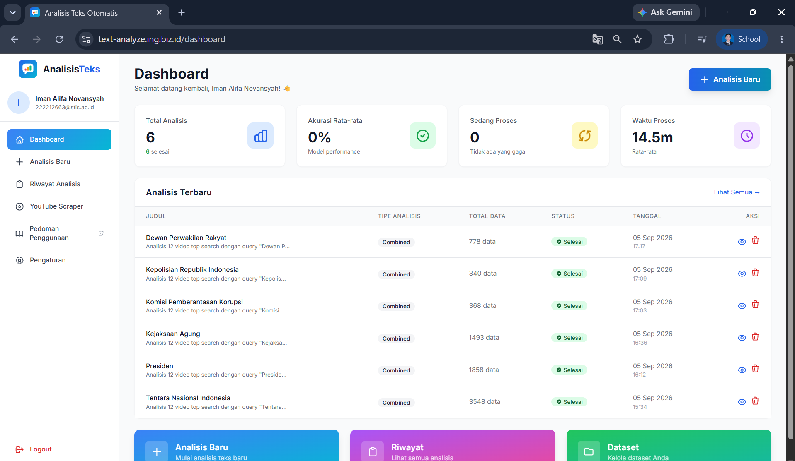
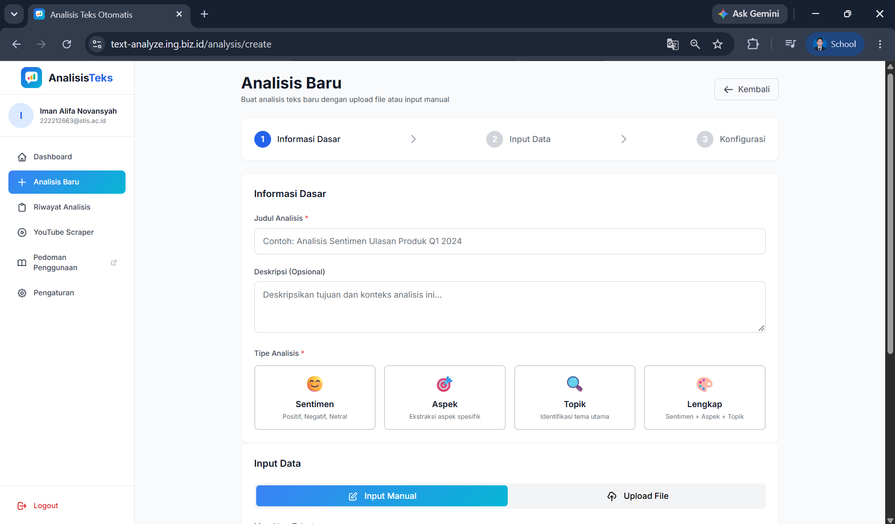
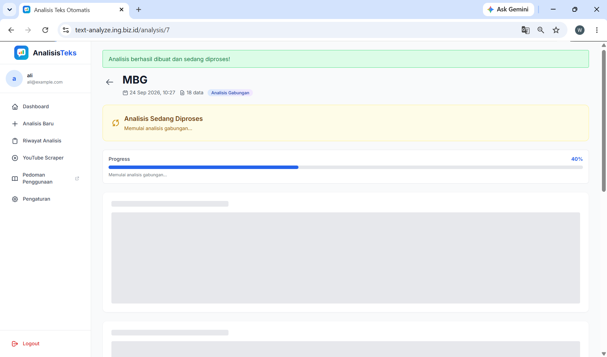
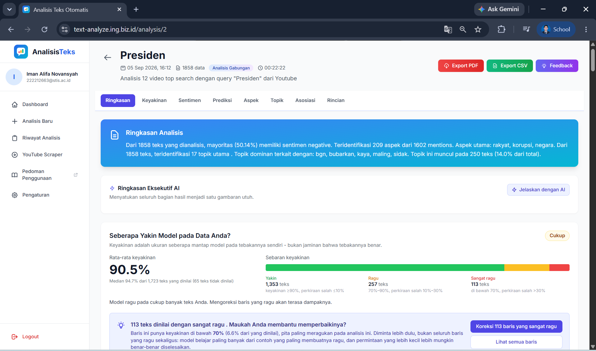
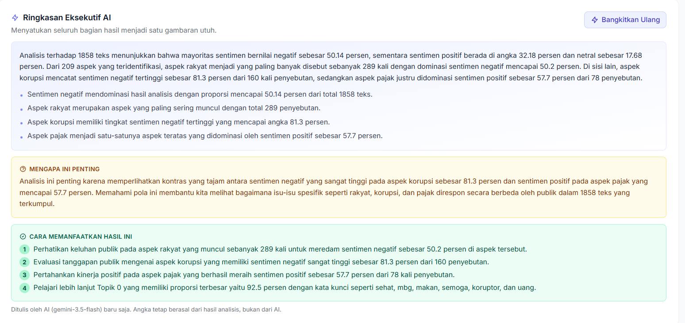
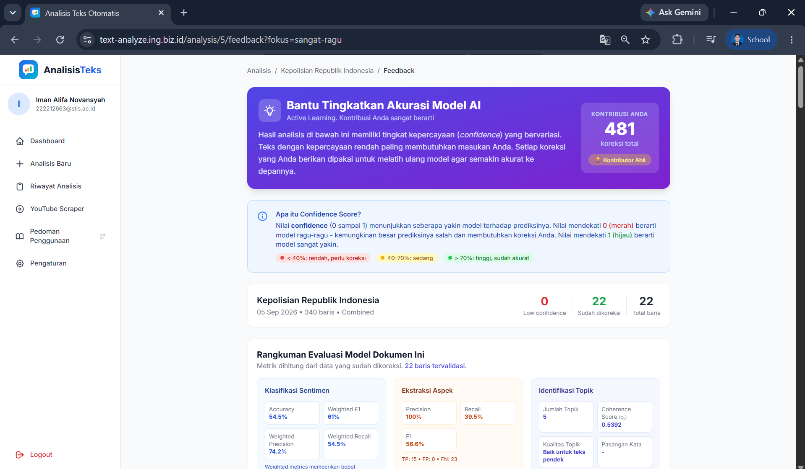

# Panduan Penggunaan

Panduan ini menjelaskan cara memakai aplikasi, dari membuat akun sampai
mengekspor hasil. Versi interaktifnya, lengkap dengan video, tersedia di dalam
aplikasi pada halaman **Pedoman Penggunaan**
(<https://text-analyze.ing.biz.id/panduan>), yang bisa dibuka tanpa login.

Daftar isi:

1. [Sebelum mulai](#1-sebelum-mulai)
2. [Menyiapkan data](#2-menyiapkan-data)
3. [Menjalankan analisis](#3-menjalankan-analisis)
4. [Menunggu proses](#4-menunggu-proses)
5. [Membaca hasil](#5-membaca-hasil)
6. [Memperbaiki hasil (koreksi)](#6-memperbaiki-hasil-koreksi)
7. [Menyimpan hasil](#7-menyimpan-hasil)
8. [Mengambil komentar YouTube](#8-mengambil-komentar-youtube)
9. [Pengaturan](#9-pengaturan)
10. [Fitur admin](#10-fitur-admin)
11. [Istilah](#11-istilah)
12. [Bila ada masalah](#12-bila-ada-masalah)
13. [Skenario latihan](#13-skenario-latihan)

---

## 1. Sebelum mulai

Buka aplikasi, pilih **Daftar** untuk membuat akun (nama, email, kata sandi),
lalu **Masuk**. Setelah masuk, menu di sisi kiri berisi:

| Menu | Kegunaan |
|---|---|
| Dashboard | Ringkasan analisis yang pernah Anda jalankan |
| Analisis Baru | Memulai analisis: memilih data, jenis analisis, dan pengaturannya |
| Riwayat Analisis | Daftar seluruh analisis Anda; hasil lama dibuka lagi dari sini |
| YouTube Scraper | Mengambil komentar dari video YouTube untuk langsung dianalisis |
| Pedoman Penggunaan | Versi interaktif panduan ini, dengan video |
| Pengaturan | Preferensi analisis, data akun, dan kata sandi |

## 2. Menyiapkan data

Ada tiga cara memasukkan data:

| Cara | Langkah | Catatan |
|---|---|---|
| Ketik atau tempel langsung | Pada tab **Input Manual**, tulis satu teks per baris | Cara tercepat untuk mencoba. Baris kosong diabaikan |
| Unggah berkas | Pada tab **Upload File**, seret berkas CSV, TXT, XLSX, atau XLS ke kotak unggah | Untuk CSV dan Excel, tunjuk kolom yang berisi teks |
| Ambil dari YouTube | Lewat menu **YouTube Scraper** (bagian 8) | Berkas hasil scraping langsung terpasang di formulir analisis |

Batas: maksimal 10.000 teks per analisis, dan 10.000 karakter per teks.
Berkas contoh untuk mencoba ada di
[`dataset/contoh/contoh-komentar.csv`](../dataset/contoh/contoh-komentar.csv).

## 3. Menjalankan analisis

Buka **Analisis Baru**, lalu:

1. **Beri judul yang menjelaskan isinya.** Judul ini yang muncul di Riwayat
   Analisis.
2. **Pilih jenis analisis** (lihat tabel di bawah).
3. **Masukkan datanya** lewat Input Manual atau Upload File.
4. **Tentukan kolom teks** (khusus CSV/Excel). Centang apakah baris pertama
   berisi nama kolom, pilih kolom teks, lalu periksa pratinjaunya.
5. **Pilih kolom pemisah bila ada** (opsional, maksimal tiga), misalnya ID
   video, tanggal, atau sumber. Hasilnya nanti bisa dipecah per kelompok tanpa
   menjalankan analisis ulang.
6. **Periksa pembersihan teks.** Konfigurasi bawaan sudah sesuai untuk
   kebanyakan data. Tombol **Pratinjau** memperlihatkan teks setelah
   dibersihkan.
7. Untuk analisis topik atau gabungan, pilih **jumlah topik**: Otomatis, atau
   2–20.
8. Tekan **Jalankan Analisis**.

| Jenis | Pertanyaan yang dijawab | Kapan dipakai |
|---|---|---|
| Sentimen | Secara keseluruhan, orang bernada positif, negatif, atau netral? | Mengukur penerimaan atau kepuasan |
| Aspek | Hal apa yang sebenarnya dikeluhkan atau dipuji? | Mencari sasaran perbaikan, bukan sekadar suasana hati |
| Topik | Tema besar apa yang muncul dari kumpulan teks? | Data banyak dan isinya belum diketahui |
| Gabungan | Ketiganya sekaligus, ditambah keterkaitan aspek dan topik | Butuh gambaran menyeluruh, atau belum yakin mana yang dibutuhkan |

## 4. Menunggu proses

Analisis berjalan di latar belakang. Halaman hasil menampilkan bilah kemajuan
yang diperbarui otomatis. Seribu teks memakan sekitar lima menit untuk
analisis gabungan; analisis pertama setelah layanan dinyalakan ulang lebih
lambat karena model dimuat lebih dulu.

Halaman boleh ditutup. Proses tetap berjalan di server, dan hasilnya dibuka
lagi lewat **Riwayat Analisis**.

## 5. Membaca hasil

Bilah navigasi di atas halaman hasil melompat ke tiap bagian.

| Bagian | Isi |
|---|---|
| Ringkasan Analisis | Beberapa kalimat tentang temuan utama. Baca ini dulu |
| Ringkasan Eksekutif AI | Penjelasan yang menyatukan seluruh bagian, alasan mengapa penting, dan langkah tindak lanjut. Muncul setelah tombolnya ditekan |
| Seberapa Yakin Model | Seberapa besar hasil bisa dipercaya, dan ajakan mengoreksi teks yang dinilai dengan ragu |
| Distribusi Sentimen | Grafik dan porsi positif, netral, dan negatif |
| Detail Prediksi | Daftar tiap teks beserta penilaiannya; bisa disaring per sentimen dan dicari |
| Analisis Aspek | Hal yang paling banyak dibicarakan beserta nada tiap aspek |
| Topik | Tema yang terbentuk, kata kunci, word cloud, dan ukuran mutunya |
| Asosiasi Aspek–Topik | Aspek mana yang sering muncul bersama topik mana (PMI) |
| Rincian per Pemisah | Hasil per kelompok, bila kolom pemisah dipilih |

**Tombol Jelaskan dengan AI** pada tiap bagian meminta penjelasan naratif dari
Gemini. Penjelasan ini hanya lapisan tambahan: seluruh angka tetap berasal dari
model analisis, dan halaman tetap lengkap tanpa penjelasan AI. Model dan
tanggal pembangkitan dicantumkan di bawah setiap penjelasan.

## 6. Memperbaiki hasil (koreksi)

Koreksi Anda dipakai melatih ulang model (*active learning*), sehingga analisis
berikutnya lebih tepat.

1. **Buka halaman koreksi** dari tombol pada panel keyakinan di halaman hasil,
   atau dari Riwayat Analisis.
2. **Mulai dari baris yang ragu.** Penyaring di atas membatasi daftar pada teks
   yang model sendiri tidak yakin. Di sanalah kesalahan paling mungkin ada.
3. **Perbaiki yang keliru.** Pilih sentimen yang benar. Bila aspeknya salah
   atau kurang, sunting kolom aspek. Bila model sudah benar, tetap pilih
   sentimennya; menegaskan jawaban yang benar juga berguna.
4. **Lewati yang Anda ragukan.** Biarkan kosong; baris yang tidak ditinjau
   tidak ikut tersimpan.
5. Tekan **Kirim Koreksi**. Seluruh koreksi pada analisis itu terkirim
   sekaligus, termasuk yang dibuat di halaman sebelumnya. Bila jumlahnya sudah
   mencukupi, model dilatih ulang otomatis di latar belakang.

Koreksi yang belum terkirim tersimpan sementara di peramban, jadi berpindah
halaman tidak menghilangkannya.

## 7. Menyimpan hasil

Di halaman hasil:

- **Export PDF**: ringkasan hasil analisis, termasuk penjelasan AI bila ada.
- **Export CSV**: hasil per teks dengan kolom `no`, `teks`,
  `teks_preprocessed`, `sentimen`, `confidence`, dan `aspek`.

## 8. Mengambil komentar YouTube

1. Buka **YouTube Scraper**.
2. Cari video dengan kata kunci, atau tempel tautan video.
3. Pilih video, tentukan jumlah komentar, lalu jalankan pengambilan.
4. Unduh hasilnya (CSV, XLSX, atau TXT), atau tekan **Analisis Sekarang**:
   formulir analisis terbuka dengan berkas itu sudah terpasang, dan seluruh
   pengaturan masih bisa diubah sebelum dijalankan.

Fitur ini membutuhkan `YOUTUBE_API_KEY`. Bila kuota API habis, aplikasi
mencoba `yt-dlp` sebagai cadangan.

## 9. Pengaturan

Menu **Pengaturan** berisi:

- **Preferensi Analisis**: konfigurasi pembersihan teks yang otomatis terpilih
  saat membuat analisis baru.
- **Data akun**: nama dan email.
- **Kata sandi**.
- **Hapus akun**.

## 10. Fitur admin

Akun ber-`role` admin mendapat dua menu tambahan. Keduanya untuk pengawasan;
aplikasi tetap berjalan penuh tanpa admin.

### Data latih (`/admin/training`)

- Statistik data koreksi dan riwayat pelatihan ulang (status, jumlah sampel,
  ukuran set validasi, perubahan F1, suhu kalibrasi, sidik jari kolam).
- Tombol **Periksa Data Latih**: distribusi label, ketimpangan kelas, dan
  akurasi tebak-kelas-mayoritas sebagai pembanding.
- Tombol **Latih Ulang**: memilih analisis asal dan model (sentimen, aspek,
  atau keduanya). Penjaga yang sama dengan pelatihan otomatis tetap berlaku;
  centang **paksa** untuk melewatinya dengan sengaja.
- **Mode tunda**: menahan pelatihan otomatis selama fase uji coba, lalu
  memutar ulang pemicunya setelah golden dataset siap.
- Pengelolaan stopword tambahan dan ekspor CSV data koreksi.

### Evaluasi (`/admin/evaluation`)

1. **Ambil Sampel dari Korpus**: sampel acak berstrata dari analisis yang
   sudah ada, menghasilkan berkas anotasi kosong.
2. **Anotasi** berkas itu mengikuti [PEDOMAN_ANOTASI.md](PEDOMAN_ANOTASI.md),
   lalu unggah kembali.
3. **Bekukan** dataset. Isinya terkunci dan tidak bisa lagi dipakai sebagai
   data latih.
4. **Jalankan Evaluasi** untuk mengukur model aktif. Hasilnya: akurasi dengan
   selang kepercayaan, macro-F1, kappa, F1 aspek, mutu topik, dan perbandingan
   antar iterasi dengan uji McNemar.

Prosedur lengkapnya ada di [PANDUAN_EVALUASI.md](PANDUAN_EVALUASI.md).

## 11. Istilah

| Istilah | Arti |
|---|---|
| Sentimen | Nada sebuah teks: positif, negatif, atau netral |
| Aspek | Objek yang dinilai di dalam teks. Pada "pelayanannya lambat", aspeknya "pelayanan", bukan "lambat" |
| Topik | Kelompok teks yang membicarakan tema serupa, ditemukan sistem tanpa daftar kategori yang ditentukan lebih dulu |
| Keyakinan (*confidence*) | Angka 0 sampai 1 yang menunjukkan seberapa yakin model. Makin rendah, makin perlu diperiksa manusia |
| Perlu ditinjau | Penanda pada teks yang keyakinannya di bawah ambang (0,90). Bukan berarti salah, tetapi di sanalah kesalahan paling sering ada |
| Preprocessing | Pembersihan teks sebelum dianalisis: case folding, pembuangan tanda baca, stopword removal, dan stemming |
| Koherensi topik | Seberapa sering kata kunci satu topik benar-benar muncul berdekatan dalam teks yang sama |
| Active learning | Koreksi pengguna dikumpulkan lalu dipakai melatih ulang model |
| Golden dataset | Kumpulan teks berlabel manusia yang dipakai khusus untuk menguji model, tidak pernah dilatihkan |

## 12. Bila ada masalah

| Gejala | Penyebab dan jalan keluar |
|---|---|
| Analisis lama di status "sedang diproses" | Untuk korpus besar ini wajar. Bila tidak bergerak lebih dari satu jam, worker antrean di server kemungkinan tidak berjalan |
| Kolom teks yang dipilih ternyata salah | Jalankan analisis baru dengan kolom yang benar; analisis yang salah bisa dihapus dari Riwayat Analisis |
| Tombol Kirim Koreksi tidak bisa ditekan | Tombol aktif setelah minimal satu baris ditinjau. Pilih sentimen pada salah satu teks, atau ubah kolom aspeknya |
| Tombol Jelaskan dengan AI memberi pesan galat | Layanan AI punya batas harian dan batas sepuluh permintaan per menit. Tunggu sebentar lalu coba lagi |
| Hasil aspek kosong | Teksnya sangat pendek atau tidak menyebut objek apa pun dengan jelas. Analisis sentimen tetap berjalan |
| Halaman ditutup saat analisis berjalan | Tidak masalah. Proses berlanjut di server; buka lagi lewat Riwayat Analisis |

## 13. Skenario latihan

Enam tugas berurutan yang mencakup seluruh alur utama. Skenario ini juga
dipakai pada uji kegunaan (CSUQ).

| No | Tugas | Selesai bila |
|---|---|---|
| 1 | Masuk ke aplikasi, lalu temukan menu Analisis Baru | Formulir analisis baru terbuka |
| 2 | Jalankan satu analisis dengan mengetik minimal sepuluh kalimat pada tab Input Manual. Pilih jenis Analisis Gabungan | Halaman hasil terbuka dan statusnya selesai |
| 3 | Temukan berapa persen teks yang bernada negatif, lalu baca satu contoh teks negatif dari daftar prediksi | Anda bisa menyebutkan angka dan satu kalimat contohnya |
| 4 | Tekan tombol Jelaskan dengan AI pada salah satu bagian hasil, lalu baca langkah tindak lanjut yang disarankan | Blok penjelasan muncul dengan daftar langkah bernomor |
| 5 | Buka halaman koreksi, perbaiki minimal tiga baris yang menurut Anda keliru, lalu kirim | Muncul pesan bahwa koreksi tersimpan |
| 6 | Ekspor hasil analisis tersebut sebagai PDF | Berkas PDF terunduh |
